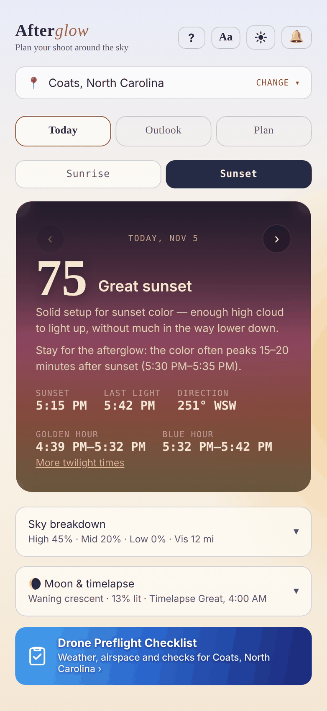
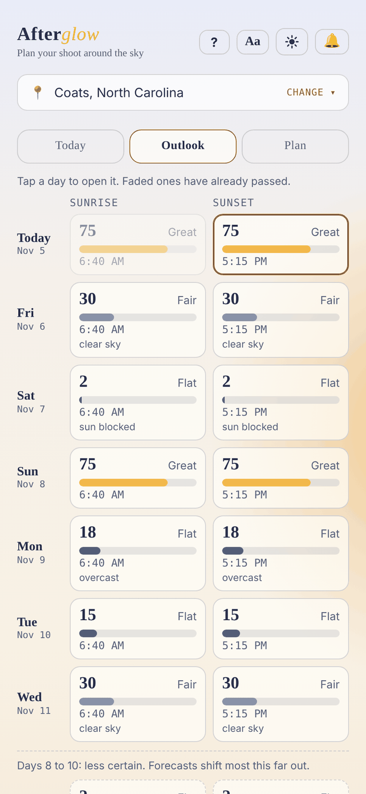
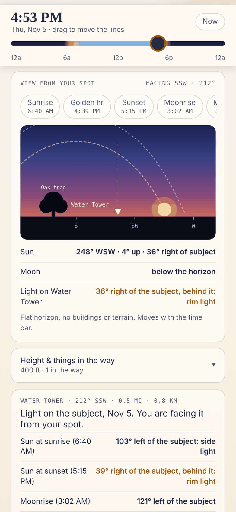

# Afterglow

**Sunrise and sunset sky-quality forecasts, built for photographers and drone pilots.**

🔗 [afterglow.johnstonaerial.com](https://afterglow.johnstonaerial.com)

📖 **[How to use Afterglow](HOW-TO.md)** — installing, notifications, the Plan tab and reading the score

Afterglow predicts how good a sunrise or sunset is actually going to look — not just whether the sun is up, but whether the sky will put on a show. Built for planning drone shoots, timelapses, and just knowing when to grab a camera.

☕ **Free to use.** If it helped you catch an epic shot — sunrise, sunset, or a moon timelapse — you can [buy me a coffee](https://buymeacoffee.com/JohnstonAerial).

## Screenshots

<table>
  <tr>
    <td align="center" width="33%"><picture><source media="(prefers-color-scheme: dark)" srcset="screenshots/01-today-dark.png"></picture> <b>Today</b></td>
    <td align="center" width="33%"><picture><source media="(prefers-color-scheme: dark)" srcset="screenshots/02-outlook-dark.png"></picture> <b>Outlook</b></td>
    <td align="center" width="33%"><picture><source media="(prefers-color-scheme: dark)" srcset="screenshots/03-plan-dark.png"></picture> <b>Plan</b></td>
  </tr>
</table>

Pictures use sample forecast numbers and the Coats, NC area. They follow your light or dark setting on GitHub.

## What's new

**2.4.2**
- **Share links and the QR code carry more.** A link to a plan (and the QR code on the printed shoot card) now includes your Things in the way, the Subject's shape ("Looks like"), whether you're on the ground or in the air and how high, and the shoot window. When someone opens it, those things are added to that place on their device. Your notes and units are not included.
- **Saving a thing in the way tells you what's missing.** If a height or distance is blank, the Save form now marks the box and says so instead of doing nothing.
- **A new printed shoot card.** The compass shows each thing in the way as a shaded wedge, the Subject's distance is on it, and a small picture of the horizon at sunrise or sunset shows where the Sun or Moon will be. The QR code sits at the top right so it is always on page 1. Notes over 200 characters print on page 2.

**2.4.1**
- **View from your spot is the right size on a big screen.** On a Mac, iPad or other wide window the picture stops growing, so its text no longer gets huge.
- **Shorter Sun and Moon tags.** When the Sun or Moon is off the side of the picture, the tag now reads like "← Sun · 112° · 28° up". The arrow shows the side, and the rows under the picture give the full details. The tags also stay clear of the Subject label and of each other.

**2.4.0**
- **Drone Preflight Checklist button.** A blue button on **Today** (under Moon & timelapse) and on **Plan** (under the Sky forecast) opens the free Drone Preflight Checklist with the weather and airspace for your place already loaded. It says which place it will use. On Plan it uses the place you're planning from. The checklist's own **AfterGlow** button works the other way and opens Afterglow at the checklist's place, on Today.
- **A new look.** In dark mode, a soft gold glow along the right edge, like light at the horizon. In light mode, the page has a dawn-sky wash, from pale blue at the top through cream to a soft peach, with the same gold glow. The text, buttons and colors of the score card are unchanged.
- **View from your spot.** On the Plan tab, a new card under the time bar draws a flat horizon facing your Subject, with the Sun and Moon where they will be at the time on the bar. A dotted line shows each one's path. If the Sun or Moon is off the side or above the picture, a small tag says which way and how far. With no Subject pin, it faces the nearer of sunrise or sunset. The **Jump to** buttons (sunrise, golden hour, sunset, moonrise, moonset) sit at the top of the card as a row you can swipe sideways.
- **Draw what's in the way.** Trees, buildings, hills, towers and walls you add under Things in the way are drawn in the picture at their real direction and height, and the Sun or Moon row says when one is behind them. Pick a "Looks like" shape for your Subject (water tower, bridge, lighthouse, steeple, turbine and more) and it is drawn in the middle.
- **Type coordinates any way you have them.** Decimal degrees, degrees/minutes/seconds, survey style, compact aviation style (351230N 0783015W) or a pasted Google or Apple Maps link all work, in the Change location box and in Plan's search. In the US the place is named "Near <town>, ST".
- **Return works in Change location.** Press Go on the keyboard to pick the top result.
- **My location** is the same button, with a crosshair icon, on Today and Plan.
- **Plan page order.** View from your spot, Things in the way, the Subject card, Sky forecast, the checklist button, Find dates, then the top-down Sky view (closed) and Share, calendar & print. The forecast now sits close to the picture, so you can read it as you step from date to date.
- **Name this spot** moved up, to a row under the map-tap buttons, and appears once you've dropped a Subject pin.
- **The footer link** to the Drone Preflight Checklist now reads "Free Drone Preflight Checklist".

**2.1.1**
- **Outlook shows 10 days.** Days 8 to 10 have a dashed outline and a note that they are less certain, because forecasts shift most that far out. Today shows the same note on those days.
- **Outlook says why.** A Flat or Fair day gets a short reason underneath (low cloud, sun blocked, overcast, rain likely, hazy, clear sky).
- **Closed sections say more.** Sky breakdown, Moon & timelapse, Height & things in the way and Find dates now show a one-line summary in their header.
- **Close links.** Open sections have a **Close ▲** link at the bottom so you don't have to scroll back up.
- **Plan no longer lets you pick days in the past**, and the date row fits small screens with Larger text on.
- Today's date line, the Things in the way form and a few long messages were tightened so nothing is cut off on narrow phones.

**2.1.0**
- **Light mode.** A new button in the header opens a **Theme** menu with **Auto**, **Light** and **Dark**. Auto follows your device setting and is the default. The big sky card stays dark on purpose in light mode.
- The **ⓘ About** button is now a small **?** that opens this README.
- The map's locate button (full screen) now frames your spot and your subject together above the bottom panel.
- The calendar before/after box is no longer cut off, and a few smaller light-mode touches (coffee cup, card tint, round date arrows).

**2.0.4**
- **Full screen map.** On the Plan tab, tap **⤢** on the map to fill the whole screen. A panel along the bottom has the time slider, **Now**, quick jumps (sunrise, golden hour, sunset, moonrise) and a **Subject / Your spot** switch, so you can watch the Sun and Moon lines move across the map. Tap **✕** (or press Esc) to close it, and the small map re-fits so your spot and your subject are both in view.

**2.0.3**
- A tagline under the name ("Plan your shoot around the sky"), and the version number moved to the bottom of the page.
- A link to the free Drone Preflight Checklist ("Also from Johnston Aerial") in the footer.
- A new preview image and description when you share a link to Afterglow.
- The Sky breakdown and Moon & timelapse cards wrap cleanly on small screens and with larger text.

**2.0.2**
- On the Plan map, the **⌖** button now returns to the place you were planning from before you dropped a pin (for example My location), instead of your saved place.

**2.0.1**
- One place control, in the same spot on every tab.
- The bell window shows which place your alerts are for.
- Clearer saved-place wording, and install steps added to the how-to guide.

## What's new in 2.0

Afterglow 2.0 is a big redesign of the Plan tab, with a few new tools.

- **Plan tab, rebuilt.** A time bar that stays at the top, a clear "Planning from" place, a **Subject** and **Your spot** you place on the map, a sky view, and less clutter. Rarely used tools are folded away until you need them.
- **Calendar, your way.** Add a shoot to your calendar at sunrise or sunset, or choose **Custom**: start 2 hours before sunset, 30 minutes before moonrise, at a clock time, or at the time on the bar, for as long as you like.
- **Alerts with a minimum forecast.** Sunrise and sunset alerts can wait until the forecast is Good, Great or Epic, and tell you the score. Poor skies stay quiet.
- **My location**, everywhere. One button in the place pickers, and your saved place only changes when you tap it.
- **Larger text** with the **Aa** button.
- **Easier Today and Outlook.** Day arrows on Today, past times dimmed on Outlook, and tap a day to open it.
- **Kinder to computers.** Scrolling over the map scrolls the page. Zoom with +/−, or ⌘/Ctrl + scroll.
- **Fixes.** Location works on Chrome for Mac, and the Plan sky forecast no longer gets stuck on "Reading the sky…".

## Features

- **Sky quality scoring** — a heuristic model based on published sunset-photography guidance: mid/high cloud in the right range catches color, low cloud blocks it, haze flattens it. Scores are checked against real shoots and still being refined. Like any forecast, it can miss, especially on high cloud.
- **Golden & blue hour, precisely** — computed from actual solar angle (civil twilight math), not flat clock-time offsets. Nautical and astronomical twilight times shown when they fall that day.
- **Outlook** — the coming sunrises and sunsets, each scored, with past times dimmed.
- **Any location** — search by city, state or ZIP, type coordinates, or use your current position, and switch any time with the location button. Your chosen location stays on your device.
- **Moon conditions** — phase, illumination, moonrise/moonset with compass headings, and a callout for the "big warm moon on the horizon" alignment window. Includes an hourly timelapse-conditions score.
- **Plan tab** — Sun and Moon direction and height at any time, on any date, anywhere, on a free, keyless Leaflet/OpenStreetMap map that also opens full screen. Place a subject, find the dates the Sun or Moon lines up with it, allow for height and obstructions, share a link, add the shoot to your calendar, or print a shoot card.
- **Three tabs** — Today, Outlook and Plan.
- **Installable app (PWA)** — add it to your Home Screen on iOS or Android for a real standalone app experience, with offline support for the app itself (forecast data always pulls fresh, never stale).
- **Push notifications** — optional alerts before sunrise, sunset, or golden hour (morning and evening), sent right to your phone. You choose which alerts you want and how far ahead: 15, 30, 60 or 90 minutes, and sunrise and sunset alerts can wait for a minimum forecast (Good or better, Great or better, or Epic only). Notifications need the app installed (Home Screen on a phone or tablet, Dock or app window on a computer) (see the [how-to](HOW-TO.md)).
- **Built-in resilience** — automatic retry with backoff, cached last-known data with a clear "stale" indicator, and plain-language error messages instead of raw failures.

## How it works

- New to Afterglow? The [how-to guide](HOW-TO.md) covers installing, notifications and reading the score.

- Forecast data comes from [Open-Meteo](https://open-meteo.com/) — free, no API key required.
- Moon phase, moonrise and moonset are calculated on your device with [Astronomy Engine](https://github.com/cosinekitty/astronomy) (MIT licence, by Don Cross). Nothing about your location is sent anywhere for this, and it works offline. Checked against the US Naval Observatory, rise and set times agree to within a minute.
- Cloud cover is sampled along the sun's actual azimuth (not just overhead) using great-circle geometry, to judge whether direct light can actually reach the horizon.
- Notifications run on a Cloudflare Worker with a scheduled check every 5 minutes, using Web Push — no app store, no third-party notification service.

## Good to know

- Weather models update a few times a day, so a forecast can change when a new run arrives. Check again closer to the time, especially for sunsets more than a day out.
- Color often peaks a little after sunset (15–20 minutes) or just before sunrise, so Afterglow shows that window on the main card for Fair and better days.
- Scores run from Flat to Fair, Good, Great and Epic. Treat them as a guide to the odds, not a promise.

## Tech

Single-file HTML/CSS/JS front end, no build step. Notification backend is a standalone Cloudflare Worker (`worker.js`) using only the Web Crypto API — no external push libraries. Visits are counted with [Cloudflare Web Analytics](https://www.cloudflare.com/web-analytics/).

## Status

Actively used and evolving. Scoring constants (cloud sweet-spot ranges, murk-penalty thresholds, sampling distance) are being refined against real shoot outcomes over time.

## Privacy

Afterglow has no accounts and no ads. Your chosen location stays on your device, except when you turn on notifications: then that location, your alert choices and your phone's push address are stored so the alerts can be sent, and they're removed when you turn notifications off. The page also uses Cloudflare Web Analytics, a privacy-focused visit counter. It counts visits and rough details like country and device type, with no cookies and no personal information, so I can see whether Afterglow is being used.

## Support this project

Afterglow is free. If it's saved you time, or helped you catch an epic sunset, sunrise, or moon shot you'd have otherwise missed, you can [buy me a coffee ☕](https://buymeacoffee.com/JohnstonAerial). It helps cover the time I put into keeping it accurate.

Thank you, and good light.
— Jim, Johnston Aerial
---

Built by [Johnston Aerial](https://johnstonaerial.com).
